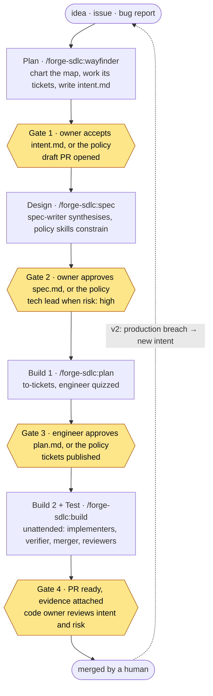
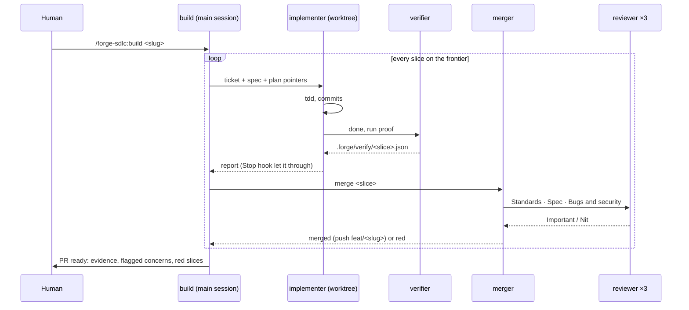

# forge-sdlc: design

**Status:** built, 2026-10-17. Slices 1–10 of section 15 were built by a crew from this document and `docs/contracts.md`; the decisions taken during the build are the `Decision:` lines under the tables and the ADRs in `docs/adr/`.

A Claude Code plugin that runs the [AI-native SDLC playbook](https://claude.com/resources/articles/the-ai-native-sdlc-playbook) as a team of agents, using [Matt Pocock's skills](https://github.com/mattpocock/skills) as the procedures. Generic: any stack, GitHub (`gh`) or a local-markdown tracker, no company assumptions.

Decisions already taken (from the kickoff questions):

| Question | Decision |
| --- | --- |
| Deliverable | A Claude Code plugin, `forge-sdlc`, after this design is agreed |
| Lineage | Generic, from scratch. Ideas borrowed from the eMAG `prior-sdlc` plugin, no code |
| Matt's skills | A dependency on `mattpocock-skills@claude-plugins-official`, not a vendored copy |
| Scope of v1 | Plan, Design, Build, Test. Deploy and Maintain are v2 |

## 1. What it is

The playbook says build is no longer the constraint; planning, review and deployment are. Its answer is a **loop** where every stage commits an artifact, the next stage reads it, a human gates between them, and controls are enforced in code (skills advise, hooks enforce).

Matt's skills already cover the procedures of each stage: `grilling` and `wayfinder` to align, `to-spec` and `to-tickets` to specify, `implement-spec` with `tdd` and `code-review` to build, `pr` to ship, `retro` to maintain the environment. What they do not provide is the **frame**: which artifact gets committed where, who may edit what when, which agent runs which step with which tools, and where the human is asked.

`forge-sdlc` is that frame:

- **One pushed branch per effort**, `feat/<slug>`: the map, `intent.md`, `spec.md`, `plan.md` and the merged code all commit on it, one folder, one pull request. Slice branches are local and never pushed.
- **A team of seven agents** with scoped tools and fixed roles, dispatched by the plugin's skills.
- **Hooks as guardrails** for the rules the playbook says must not depend on the model remembering them.
- **Three human gates**, each a state of the same pull request.

### Goals

1. One command per effort, `/forge-sdlc:wayfinder`, from an idea to a reviewable pull request, with the human asked only at the gates. Every effort starts as a wayfinder map and resumes from the same command.
2. Playbook fidelity where it matters: artifacts in git, gates as deterministic states, verification before "done", evals for the plugin itself.
3. Matt's skills used **unmodified**. The plugin names the skill and adds the frame; it never re-implements a procedure.
4. Works on a solo repo with no remote (local tracker) and on a GitHub repo (`gh`), from the same host config.

### Non-goals (v1)

- Deploy and Maintain stages: `REVIEW.md`-driven PR review bot, production gate hook, incident intent, scheduled scans. Section 14 lists the hook points so v2 slots in.
- Any UI inside Claude Code (panes, bands, status lines).
- Company integrations: Jira, GitLab, code search servers, PII fixture scanning, legacy-page migration. A generic secrets scan stays.
- Multi-repo efforts.

## 2. How the two sources combine

| Playbook gives | Matt's skills give | forge-sdlc adds |
| --- | --- | --- |
| The six stages, loop not line | The procedure inside each stage | The commands that chain them and stop at gates |
| "Every stage commits an artifact" | Spec and ticket templates | Where each artifact lives, who commits it, when it freezes |
| "Skills advise, hooks enforce" | Advice (seams, smells, tracer bullets) | The hooks that enforce the non-negotiables |
| Subagents with scoped tools, one worktree per task | `implement-spec`: implementer and merger roles, frontier | The agent files: model, effort, tools, brief |
| Human gates by role | `to-tickets` quizzes the engineer | Gates as PR states; the engineer, owner and tech-lead gates named |
| Quantifiable "done", evidence attached | `pr`: before/after evidence | A verifier agent whose record the Stop hook reads |
| Continuous evals of the agent setup | `retro` | `claude plugin eval` suites for the plugin itself |

## 3. The loop



Yellow is where a human decides. Between gates nothing asks a question: a choice the artifacts leave open takes the reading the artifacts support and is recorded as an assumption line for the next gate. Who passes Gates 1 to 3 is the host's gate policy: under `attended`, the default, the human at each one; under `autonomous`, the policy whenever the gate's artifact has no `open:` line, no flagged concern and normal risk, so one `wayfinder` run goes on to the first stop or Gate 4, which is always the code owner's.

### Stage map

| Playbook stage | Artifact committed | Matt's skills used | forge-sdlc command | Agents | Human gate (playbook role) |
| --- | --- | --- | --- | --- | --- |
| Plan | `map.md`, then `intent.md` | `wayfinder` (the map), `grilling`, `domain-modeling` for its grilling tickets; `research`, `prototype` for its other tickets | `wayfinder` (`intent` by hand) | researcher, prototyper (map tickets) | Product owner accepts the intent; under `autonomous`, the policy when nothing is open |
| Design | `spec.md` | `to-spec` (procedure and template), `codebase-design` | `spec` | spec-writer | Product owner approves; tech lead when the effort is `risk: high`; under `autonomous`, the policy when nothing is open or flagged |
| Build (plan) | `plan.md` + tickets on the tracker | `to-tickets` | `plan` | none (HITL quiz in the main session) | Engineer approves the breakdown; under `autonomous`, the policy answers the quiz with it |
| Build (code) | commits on `feat/<slug>` | `implement-spec` (frame), `tdd`, `codebase-design` | `build` | implementer, merger | none |
| Test | `.forge/verify/*.json` evidence, review records | `code-review` (two axes, plus a third), `pr` | inside `build`; `slice-review` by hand | verifier, reviewer ×3 | Code owner reviews the PR with evidence attached |
| Deploy, Maintain | v2 | `retro` today | v2 | v2 | Release manager, service owner (v2) |

The playbook's `plan.md` (files, order of work, risks, proof) is the **ticket breakdown**: each tracer-bullet slice is a plan entry with its blockers and its proof. One file per effort, not one per slice, because the slices are already sized to a single context window and the engineer approves them together.

## 4. Artifacts: where they live and when they freeze

**One effort, one folder, one pushed branch, one PR.** `feat/<slug>` is the only ref of an effort that reaches origin.

```text
docs/efforts/<slug>/
├── map.md        # Plan:   the wayfinder map: Destination, Notes, Decisions so far, Not yet specified, Out of scope
├── intent.md     # Plan:   problem, outcome, users, constraints, open questions, assumptions
├── spec.md       # Design: to-spec template + Affected systems + Flagged concerns + Assumptions
└── plan.md       # Build:  slices (title, blocked by, delivers, proof), order of work, risks, prefactoring
```

| Artifact | Written by | Committed on | Frozen when | Source of truth |
| --- | --- | --- | --- | --- |
| `map.md` | the main session, as tickets resolve | `feat/<slug>`, first commit, then one commit per resolved ticket | never: a reopened ticket updates it | git; the tracker holds the tickets and a map issue that links to the file |
| `intent.md` | the main session with the human (HITL) | `feat/<slug>` when no ticket is open | Gate 1 passed | git |
| `spec.md` | spec-writer agent (AFK, synthesis only) | `feat/<slug>` | Gate 2 passed; `build` started makes it read-only by hook | git; tracker issue links to it |
| `plan.md` | the main session, after the engineer's quiz (the policy's, under `autonomous`) | `feat/<slug>` | Gate 3 passed | git; tickets on the tracker carry the live state (claims, frontier, closed) |
| code and tests | implementer agents, merged by the merger | local slice branches `slice/<slug>-<nn>`, merged `--no-ff` into `feat/<slug>` | PR merged | git |
| evidence | `bin/verify-record.mjs`, run by the implementer or the verifier agent | `.forge/verify/<slug>-<nn>.json` (not committed); summarised in the PR body | per slice | the PR body |

Why git, not the tracker, for the spec: Matt's `to-spec` publishes the spec to the tracker; the playbook wants a committed artifact per stage so the history is the audit trail. The tracker issue carries a **link** to `docs/efforts/<slug>/spec.md` and the `ready-for-agent` label, never a copy. Same for the map, intent and plan. Tickets stay on the tracker because that is where blocking edges, claims and the frontier live natively; on the local tracker they are files under `.scratch/<slug>/issues/`, also on the branch.

**Branches.** `feat/<slug>` is the effort branch: the map, every artifact, every research note, every merge lands on it, and only a human merges it to the default branch. Each slice gets its own local branch `slice/<slug>-<nn>` in its own worktree under `.forge/worktrees/<slug>-<nn>`, cut from the tip of `feat/<slug>`; the merger merges it `--no-ff`, then deletes the branch and the worktree. Prototypes are thrown away in their worktree; only the verdict is recorded. **Slice branches are never pushed**: a hook denies pushing any ref but `feat/<slug>`, so the PR is the only thing origin ever sees.

**The PR is the gate record.** Opened as a draft after the intent commit (GitHub) and promoted through the gates:

| Gate | PR state | What the human does |
| --- | --- | --- |
| 1 intent | draft, body leads with `## Intent` and `## Assumptions to confirm` | comments or edits `intent.md`, then runs `/forge-sdlc:wayfinder <slug>` again (or `spec` by hand); under `autonomous` the policy passes it when nothing is open and risk is normal, and the run goes on |
| 2 spec | draft, body gains `## Spec`, `## Flagged concerns` | resolves flagged concerns, approves; under `autonomous` the policy passes it when nothing is open or flagged and risk is normal |
| 3 plan | draft, body gains `## Plan` with the slice table | approves the breakdown in the quiz; the commit is the approval; under `autonomous` the quiz answers itself with the drafted breakdown, its four `recommended:` lines in a `## Quiz` block of `plan.md` and under the PR body's slice table for review at Gate 4 |
| 4 built | **ready for review**, body is the `pr` template + `## Evidence` per slice + `## Red slices` | reviews intent and risk, merges |

On the local tracker (no remote) the PR does not exist; the gate is the commit plus the human typing the next command. The commands are identical.

## 5. Commands

All user-invoked (`disable-model-invocation: true`). Type them in full with the prefix: `wayfinder`, `init`, `code-review` collide with other plugins and built-ins.

| Command | Arguments | Stage | Ends with |
| --- | --- | --- | --- |
| `/forge-sdlc:init` | | once per host, after Matt's setup | `docs/agents/forge.md` written, `### Delivery loop` block under `## Agent skills` in CLAUDE.md, `.forge/` gitignored; stops first when Matt's `setup-matt-pocock-skills` has not run |
| `/forge-sdlc:wayfinder` | `<idea>` \| `#issue` \| `<slug>` | **the front door**, Plan | charts and works the map, writes `intent.md`, opens the draft PR or `PR.md` (Gate 1); on a slug, `bin/effort-state.mjs` names the next stage, which runs and stops at its gate; under the `autonomous` gate policy the run goes on to the first stop or Gate 4 |
| `/forge-sdlc:intent` | `<slug>` | Plan, by hand | reshapes a charted map's Destination (problem, outcome, users, constraints, open questions), and a draft `intent.md` with it, without charting tickets |
| `/forge-sdlc:spec` | `<slug>` | Design | `spec.md` committed, tracker issue linked, PR body updated (Gate 2) |
| `/forge-sdlc:plan` | `<slug>` | Build 1 | engineer quizzed (the quiz self-answered under `autonomous`), tickets published, `plan.md` committed (Gate 3) |
| `/forge-sdlc:build` | `<slug>` | Build 2 + Test | unattended; PR ready with evidence and red slices (Gate 4) |
| `/forge-sdlc:slice-review` | `<slice-branch> [effort-branch]` | Test | one slice reviewed on three axes, up to two fix rounds, record `.forge/review/<slug>-<nn>.md`, verdict `clean` or `red` |
| `/forge-sdlc:status` | `[slug]` | any | read-only: the effort's stage, gate, next command, frontier, red slices, worktrees |
| `/forge-sdlc:help` | | any | opens the mod's `/forge` panel on the commands; the reply is one line pointing at it |

Decision (`intent`): it reshapes a Destination only once the map is charted; with no map it points to `wayfinder`, which names the first Destination before it charts ([ADR 0012](adr/0012-intent-needs-a-charted-map.md)).

Decision (chaining): inside the loop a forge-sdlc command runs another by reading its `SKILL.md` (wayfinder's resume, the merger's slice-review), since every command is user-invoked and the Skill tool refuses it ([ADR 0009](adr/0009-forge-commands-chained-by-file.md)).

Decision (members): every Agent call the commands make is a **member call**, defined once in `skills/build/MEMBERS.md` and linked with the member's role at each call in build, slice-review, wayfinder and spec. Before the call the lead runs `bin/crew-name.mjs <role>` (`--slice` for an implementer) and passes its line as `name`; after an implementer's call it writes the id the Agent result names as the slice's `agent`; it waits for the member's report and, under a lead with agent teams enabled, ends the teammate with the shutdown request once its work is settled. Agent teams is the transport, not crew.sh, and nothing detects it: a teams lead shows each member as a named pane, a plain lead runs the same call as a subagent. Names are display only ([ADR 0017](adr/0017-agents-as-named-members.md)).

Decision (gates): Gates 1 to 3 pass by the host's **gate policy**, `policy` under `## Gates` in `forge.md` (section 8): `attended`, the default, stops at every gate for the owner; `autonomous` passes a gate when its artifact has no `open:` line, no flagged concern and the effort is `risk: normal`, so one `wayfinder` run goes on to the first stop or Gate 4, which stays the code owner's. A stop is written as `stop` beside `gate` in the effort's state (section 9). The rule, the stop reasons, the `Gate <n> passed` report line and the state write live in `skills/wayfinder/GATE-POLICY.md`, linked by wayfinder, spec and plan ([ADR 0018](adr/0018-gates-pass-by-policy.md), superseding ADR 0006).

### `init` (once per host)

1. If `docs/agents/issue-tracker.md` is missing, tell the user to run `/mattpocock-skills:setup-matt-pocock-skills` first and stop. It owns the tracker, triage labels and domain-docs layout; `init` never duplicates those questions.
2. Explore: package manager, test runner, typecheck and lint commands, formatter, default branch, CI config, existing `docs/` layout. Derive everything derivable.
3. Ask only what cannot be derived, one section at a time, recommended answer first:
   - **Proof commands**: test, typecheck, lint, build. Derived from `package.json`, `Makefile`, `pyproject.toml`, `Cargo.toml`; confirmed.
   - **Formatter to run after edits** (or none).
   - **Spec gate**: wait at Gate 2 `always` or `only-on-open` (when an assumption is `open` rather than `recommended`).
   - **Risk globs**: paths that mark an effort `risk: high` (auth, payments, migrations, infra). Default: none.
   - **Protected branches**: default branch plus any others.
4. Write `docs/agents/forge.md` (section 8) and a `### Delivery loop` sub-block under `## Agent skills` in CLAUDE.md (or AGENTS.md, whichever exists). Re-running updates in place.

### `wayfinder` (Plan, the front door)

The one command of the loop. Every effort starts here and resumes here; `spec`, `plan` and `build` exist so a stage can be rerun by hand, not as the normal path.

1. Resolve the input. An idea in words or a tracker issue (`#123`, fetched through the tracker doc) starts a new effort. An existing slug **resumes**: read `.forge/state.json`, run the stage after the last passed gate, stop at the next gate.
2. Chart the map by following Matt's `wayfinder` (read from its file, section 10). Naming the **Destination** is the first act, and it is written under the playbook's intent headings: problem, outcome, users, constraints, open questions. Then the tickets, each `wayfinder:<type>`: **grilling** (HITL, in this session, through `grilling` and `domain-modeling`), **research** (the researcher agent), **prototype** (the prototyper agent), **task**. A small effort is a map with a Destination and no tickets: charting still happens, it just ends at once. The map body is `docs/efforts/<slug>/map.md`, committed on `feat/<slug>` as the effort's first commit and re-committed as each ticket resolves; the tracker holds the tickets (blocking, claims, frontier) and a map issue labelled `wayfinder:map` that links to the file. A decision lives on its ticket, the map only indexes it.
3. Work the map. Research tickets run in the background, in parallel; grilling and prototype tickets one at a time, the human speaking for themselves (the agent never answers its own interview). Resolving a ticket graduates fog into new tickets until no ticket is open.
4. When the way is clear, write `docs/efforts/<slug>/intent.md`: the Destination, Decisions so far, Out of scope, every gap an **assumption line** (`recommended:` the reading taken, `open:` needs the owner), and `risk:` computed from the host's risk globs. The intent is the map at the moment the way is clear, committed so Gate 1 has an artifact.
5. Commit the intent on `feat/<slug>` (created from the default branch at step 2, when the map was first committed) and on GitHub open the draft PR with the intent and the assumptions leading its body. Gate 1: under `attended`, stop; under `autonomous`, the gate policy (`skills/wayfinder/GATE-POLICY.md`) passes it when nothing is open and risk is normal, and the run goes on as a resume does.
6. On resume (`wayfinder <slug>`): `spec`, then `plan`, then `build`, each stopping at its own gate as section 5 describes; a stage whose gate the policy passed reports `Gate <n> passed` and the run continues, each next stage read by file when it starts, to the first stop or Gate 4. A comment or edit on the PR that reopens a question reopens the matching map ticket; the next resume works it before moving on.

### `intent` (by hand)

Shapes or reshapes one map's Destination through a short grilling, without charting or working tickets. For a Destination the human wants to rewrite before the map goes further, or to pin one before charting.

### `spec` (Design)

1. Precondition: `intent.md` committed on `feat/<slug>`; no `open:` assumption left in it (an `open:` line stops with the question to settle).
2. Spawn the **spec-writer** agent with pointers only: the intent, the map and its closed tickets when there is one, the glossary, the ADRs, the host's policy skills (section 8). It reads `to-spec`'s file for the template and the seam discipline and synthesises; it asks nothing.
3. The spec is Matt's template plus three sections: `## Affected users and systems`, `## Flagged concerns` (a concern a policy skill raised and the spec could not resolve) and `## Assumptions to confirm`.
4. Commit on `feat/<slug>`. Publish the tracker issue with a link and `ready-for-agent`. Update the PR body.
5. Stop at Gate 2 when the spec gate is `always`, or when an `open:` assumption or a flagged concern remains; otherwise `wayfinder` continues into `plan`. A `risk: high` effort always stops and labels the PR `needs-tech-lead`. Under `autonomous` the `spec:` key is not consulted: the gate policy alone decides, and a stop writes `stop` to the effort's state.

### `plan` (Build, the engineer's gate)

1. Precondition: `spec.md` committed and the gate passed.
2. Follow `to-tickets` (read its file): tracer-bullet slices, blocking edges, prefactoring first, expand–contract for wide refactors. Its quiz step **is Gate 3**: present the breakdown, iterate until the engineer approves. Under `autonomous` with `risk: normal` the quiz's answer is the drafted breakdown: its four answers are `recommended:` lines in a `## Quiz` block of `plan.md` after `## Prefactoring` and under the PR body's slice table, and the report says `Gate 3 passed`.
3. Each slice gets a **proof** line: the command and the observable that show it done (a test file, an e2e tag, a build target). This is the playbook's "proof" column and what the verifier runs.
4. Publish the tickets to the tracker (blockers first, native blocking edges on GitHub, `Blocked by` text locally), label `ready-for-agent`. Write `docs/efforts/<slug>/plan.md` from the approved breakdown: the slice table, order of work (the initial frontier), risks, prefactoring. Commit. Update the PR body.

### `build` (Build and Test, unattended)

`implement-spec` is the procedure, read from its file and followed step by step under this frame:

- **Integration branch** = `feat/<slug>`. Fetch, switch, never create a second one.
- **Members**: every agent below is a member call (`skills/build/MEMBERS.md`) with its role, named from the host's crew theme; the Gate 4 report gives `<slug>-<nn>: <member>` per slice.
- **Exploration subagent** (step 2) = the researcher agent, notes under `.forge/notes/<slug>/`, outside every worktree, readable by all.
- **Implementer subagents** (step 4) = the implementer agent, `subagent_type: "forge-sdlc:implementer"`, one worktree per slice under `.forge/worktrees/<slug>-<nn>` on a local branch `slice/<slug>-<nn>` cut from the tip of `feat/<slug>`, prompt is pointers only: ticket, spec, plan, effort branch, worktree path, proof line. It calls `mattpocock-skills:tdd`. It never reviews. It starts in the background and the lead records its id as the slice's `agent`, which the Stop hook gates on.
- **Verifier** runs when an implementer reports done: the verifier agent runs the slice's proof and the host's proof commands in the worktree and writes `.forge/verify/<slug>-<nn>.json` (commands, exit codes, trimmed output, timestamp, HEAD). The implementer's Stop hook reads this record: no green record, no stop (section 7).
- **Merger** (step 5) = the merger agent, one member call per finished slice. It reads the evidence record, runs `/forge-sdlc:slice-review`, merges the slice branch `--no-ff` into `feat/<slug>`, pushes `feat/<slug>`, deletes the slice branch and its worktree, resolves the ticket, and clears the slice's `agent`. Two fix rounds at most; then the slice is **red**: its branch and worktree stay for its implementer, it is listed in the PR and never merged, and never pushed. A slice blocked by a red slice is red too. Once the merger reports `merged` or `red`, the lead ends that slice's implementer and the merger.
- **Frontier** (step 6): after every merge, start implementers for every ticket now unblocked, in the background, as many as the host config allows (`max_parallel_slices`, default 3; the playbook says start with two or three and add only while review keeps pace).
- **Step 7 replaced**: every slice was reviewed on merge, so the end-of-run `code-review` does not run again. In its place the PR body is written with the `pr` template, evidence per slice from the verify records, `## Flagged concerns` carried from the spec, `## Red slices`.
- **Step 8**: mark the PR ready (GitHub), or print the branch and the red slices (local). Stop: Gate 4.
- Nothing asks a question. `AskUserQuestion` is not in the build's vocabulary; an open choice takes the reading the spec supports and is recorded on the ticket.

### `slice-review`

The merger's review, callable by hand. Spawns three **reviewer** agents in parallel on the diff `git diff <effort-branch>...<slice-branch>`, one axis each:

1. **Standards**: Matt's `code-review` step 3 (documented standards plus the Fowler smell baseline).
2. **Spec**: Matt's `code-review` spec axis against `spec.md` and the ticket.
3. **Bugs and security**: the plugin's `review/REVIEW.md` rubric (null paths, floating promises, tautological tests, injection, trust boundaries, secrets), extended by the host's `docs/agents/REVIEW.md` when present. The host file extends, never relaxes.

Findings are **Important** (blocks the merge) or **Nit** (listed, five at most, never blocks). The axes are reported side by side, never reranked (Matt's "why two axes"). Important findings go to a single fix implementer in the same worktree; the verifier reruns; the axes rerun. Two rounds, then `red`. The reviewers, the fix implementer (which keeps the slice's name) and the verifier are member calls whose lead is the merger.

## 6. The agents

Each is a file in `agents/` with `name`, `description`, `model`, `effort`, tool scoping, and a brief that fits on one screen. Prompts to agents are pointers, never pasted artifacts. Every agent runs as a **member** (section 5, Decision (members)): named from the host's crew theme, a visible pane under a lead with agent teams enabled and a subagent under a plain lead, with the same brief, tools and proof either way; no brief learns its name.

| Agent | Stage | Model, effort | Tools | Role in one line |
| --- | --- | --- | --- | --- |
| researcher | Plan, Build | Sonnet, medium | `Read, Grep, Glob, WebFetch, WebSearch, Write, Edit, Skill`; writes only under `docs/research/<slug>/` and `.forge/notes/<slug>/` | Answers one research ticket or one exploration brief from primary sources, cited, hypotheses tagged; the dispatching session commits its note under `docs/research/<slug>/` on `feat/<slug>` |
| prototyper | Plan | Opus, high; `isolation: worktree` | all but `Agent` | Resolves one prototype ticket with throwaway code in a detached worktree, answers one design question; its final message is the verdict for the ticket and the map, the code is discarded |
| spec-writer | Design | Opus, high | `Read, Glob, Grep, Write, Skill`; writes only `docs/efforts/<slug>/spec.md` | Synthesises the spec from the intent and decisions, applies policy skills, asks nothing |
| implementer | Build | Opus, high | all but `Agent` and `AskUserQuestion` | Builds one slice test-first in its worktree, calls `tdd`, commits small, runs `bin/verify-record.mjs` before it stops, never reviews; as the fix implementer it sets its slice's `mode` |
| verifier | Test | Sonnet, low | `Bash, Read` | Runs `bin/verify-record.mjs` (the slice's proof, then the host's commands), which writes `.forge/verify/<slug>-<nn>.json`; judges nothing |
| reviewer | Test | Opus, high | all but `Edit, Write, NotebookEdit, Agent` | Reviews one axis of one slice's diff, reports Important and Nit |
| merger | Build, Test | Sonnet, low | `Bash, Read, Grep, Glob, Write, Edit, Skill, Agent` | Follows slice-review, which writes the review record, then merges `--no-ff` or marks the slice red; reads evidence, never runs tests itself |

Decision (write scopes): the researcher's, spec-writer's and verifier's limits on what they write live in their briefs; no hook enforces them, and the researcher, having no Bash, leaves committing its note to the session that dispatched it ([ADR 0011](adr/0011-agent-write-scopes-held-by-the-brief.md)).

Decision (verifier): the record is written by `bin/verify-record.mjs`, not by an agent's judgement; the implementer runs it before it stops, the Stop hook names it, and `build` and `slice-review` call the verifier agent when the record is not fresh and green ([ADR 0008](adr/0008-verify-record-written-by-the-script.md)).

Decision (merger): its tools add `Bash`, `Write` and `Edit`, because the slice-review it follows writes `.forge/review/<slug>-<nn>.md` and merges through git ([ADR 0010](adr/0010-merger-writes-the-review-record.md)).

Why these splits:

- **Implementer and verifier are different agents** so "done" is a record the implementer cannot write. The Stop hook reads the verifier's file, not the implementer's claim. This is the playbook's quantifiable done.
- **Merger owns the review** so the review happens exactly once per slice with fresh context, and the implementer's report is evidence rather than a verdict.
- **Reviewer is one agent, three briefs** rather than three agents: the axis is a line in the prompt; the tools and the rubric paths differ, the role does not.
- **No simplifier agent in v1.** Matt's `tdd` keeps refactoring out of the loop and in review; the Standards axis plus the fix implementer cover it. A separate simplifier pass is a v2 candidate once the reviewer's Nits show a pattern.
- **No interviewer agent.** Plan is HITL; a subagent cannot speak for the human, so the main session runs `grilling`.

### Who does what in a build



## 7. Hooks: what is enforced

Skills advise, hooks enforce. Every hook is a Node script under `hooks/scripts/`, no dependencies, under 100 ms, reads its input from stdin, exits with the engine's allow/ask/deny contract. State comes from `.forge/state.json` and the git branch, never from the conversation.

| Hook | Event, matcher | Rule | Playbook play |
| --- | --- | --- | --- |
| protected-branch | PreToolUse Edit/Write/NotebookEdit, Bash `git commit` | Deny an edit or commit on a protected branch: the default branch plus `forge.md`'s `protected` globs; before `init`, the default branch when git can tell it | Hooks as guardrails |
| spec-frozen | PreToolUse Edit/Write | Deny edits to `docs/efforts/<slug>/spec.md`, `intent.md`, `plan.md` (in the host or a slice worktree) once that effort's `stage` is `build` or `built`; the message says to fix the code or reopen the gate | One source of truth; artifacts commit, then freeze |
| test-frozen | PreToolUse Edit/Write | Deny edits to files matching `forge.md`'s test globs while the edited file's checkout is in `fix` mode: a slice worktree reads its slice's `mode`, the main checkout on `feat/<slug>` the effort's | Commit a failing test first, fix without editing the test |
| slice-push | PreToolUse Bash `git push` | After `init`, deny pushing any ref but `feat/<slug>`, `--all` and `--mirror` included; a bare push, `HEAD` and `@` resolve to the checked-out branch. Before `init`, deny only `slice/*`. Deletes and tags pass | One pushed branch, one PR |
| secrets-in-diff | PreToolUse Bash `git commit` | Scan the lines the commit would add for credential shapes (cloud keys, `sk-`, `Bearer`, `private_key`, connection strings) and any added `.env*` file: what is staged plus what the same command stages first (`git add … &&`, `commit -a`, `commit <path>`), simulated in a throwaway copy of the index; deny, name the path and pattern, never quote the value | Keep credentials out of diffs |
| format-after-edit | PostToolUse Edit/Write | Run `forge.md`'s Formatter command on the edited file, from its checkout's root; never blocks | Run formatters after edits |
| verified-before-stop | Stop, SubagentStop | In a slice checkout (branch `slice/<slug>-<nn>`): block the stop unless `.forge/verify/<slug>-<nn>.json` in the host is green at the checkout's current HEAD; the reason is the `verify-record.mjs` command to run. It blocks whether or not the engine sets `stop_hook_active`: the per-slice block count is the loop guard. After three blocks on one slice the next stop passes once with the red reason, the slice is marked red (its `agent` cleared) and the count resets. A `SubagentStop` whose cwd names no slice is gated the same way on the slice whose `agent` in the host's state is the payload's `agent_id`, while its worktree exists; the reason names the slice and its branch, never the id | Quantifiable done; verification before completion |
| skills-version | SessionStart (startup, resume, clear) | Check the installed `mattpocock-skills` against `UPSTREAM.lock`; warn once when it is missing, another version, or has lost a locked heading | Continuous evals when the setup changes (the warning is the trigger to rerun them) |

Decision (test-frozen): fix mode belongs to a checkout, so a fix implementer on one slice freezes only that slice's tests while parallel implementers keep editing theirs ([ADR 0007](adr/0007-fix-mode-per-checkout.md)).

Decision (test-frozen, spec-frozen): both read `.forge/state.json` from the host found through git, the parent of the edited file's checkout's git common dir, falling back to the project dir outside a repo. For a session whose project dir is a slice worktree, which holds no `.forge/`, reading state from the project dir would leave the slice's tests unfrozen in fix mode and its effort's artifacts editable. This is the fix ADR 0007's consequence names, the lookup `verified-before-stop` already makes; where the project dir is the main checkout, as for a subagent or a teammate pane (whose project dir is the lead's root), the two dirs are the same and nothing changes ([ADR 0007](adr/0007-fix-mode-per-checkout.md)).

Decision (verified-before-stop): the hook does not go quiet on `stop_hook_active`, which the engine sets on the stop after a block and would make the gate one-shot. The count in `.forge/verify/<slug>-<nn>.denials` ends the loop instead: block until the record is fresh and green or three stops were refused, then allow one stop with the red reason and reset the count ([ADR 0014](adr/0014-stop-gate-counts-instead-of-stop-hook-active.md)).

Decision (verified-before-stop): a subagent's `SubagentStop` carries the lead's root as cwd, never the worktree it `cd`'d into, so the cwd branch never gated a subagent implementer. When the cwd names no slice, the hook finds the host through git from the cwd (falling back to the project dir), and gates the slice whose `agent` equals the payload's `agent_id` as a slice checkout; the lead records `agent` right after the implementer's Agent call, and the red pass clears it ([ADR 0016](adr/0016-stop-gate-finds-a-subagents-slice-by-its-agent-id.md)).

Decision (verified-before-stop): a fix round's implementer runs in the foreground inside the merger, one Agent call whose report is its return, so no `agent` is recorded for it and the agent-id branch does not gate its stop; the merger's verify step after the fix is the gate of a fix round, and a record that is not green is an Important finding of the next round. A foreground call returns its id only after `SubagentStop` has fired, and a background call would leave the merger, itself a subagent, no way to wait for the report (owner decision at Gate 4, 2026-10-19; [ADR 0016](adr/0016-stop-gate-finds-a-subagents-slice-by-its-agent-id.md)).

Not hooked, on purpose: anything a linter already enforces, and anything that would need the model's judgment (a hook decides from state and text only).

## 8. Host configuration

Written once by `init`, edited by hand later. `docs/agents/forge.md`:

```markdown
# forge-sdlc host config

## Proof commands
- test: pnpm test --run
- typecheck: pnpm tsc --noEmit
- lint: pnpm eslint .
- build: none

## Formatter
- command: pnpm prettier --write <file>   # or: none

## Branches
- default: main
- protected: main, release/*
- effort: feat/<slug>            # the only branch that is pushed
- slice: slice/<slug>-<nn>       # local, one worktree each, never pushed

## Worktrees
- dependency_dir: node_modules   # symlinked into each slice worktree; or .venv, vendor, none

## Gates
- policy: attended               # or: autonomous
- spec: always                   # or: only-on-open
- max_parallel_slices: 3

## Risk
- high: src/auth/**, src/payments/**, migrations/**

## Policy skills
- skills: security-review        # applied by the spec-writer and the reviewer; or none

## Test file globs
- globs: **/*.test.*, **/*.spec.*, tests/**

## Crew
- theme: star-trek               # a preset id (warcraft, star-trek, star-wars, got, mario), none, or free text
- names.implementer: Scotty, Miles O'Brien, Rom, Nog, Quark   # optional, one per overridden role
```

Every bullet is one `- key: value` line under its `## Section`, with an optional trailing `# comment`: that is the shape `bin/forge-config.mjs` and the hooks parse. `## Crew` holds only the crew theme and, optionally, one `names.<role>` bullet per role whose pool the owner overrides, names in display form, comma-separated; init asks the theme and writes `theme: none` on a host that picks none, and `bin/crew-name.mjs` reads the section. Two further sections are optional, never written by init and read only by the run pane mod (`plugins/forge-sdlc/hooks/ROUTING.md`): `## Routing`, `model.<role>` and `effort.<role>` bullets that override an agent file's frontmatter at spawn, and `## Mark`, the `text` and `color` of the word at the left of the band above the prompt. Under `## Gates`, `policy` is the gate policy, `attended` or `autonomous`; a missing key, or any other value, reads as `attended`, and under `autonomous` the `spec` key is ignored ([ADR 0018](adr/0018-gates-pass-by-policy.md)).

CLAUDE.md gets one sub-block, under the `## Agent skills` heading Matt's setup created, replaced in place on re-run:

```markdown
### Delivery loop

forge-sdlc runs the loop: wayfinder → intent → spec → plan → build, one folder per effort under `docs/efforts/`, one pushed branch `feat/<slug>`, one PR. Config and proof commands: `docs/agents/forge.md`.
```

Policy skills are the playbook's Design-stage idea: the spec-writer calls each listed skill by name so brand, security or compliance rules constrain the spec, and what a skill cannot resolve becomes a line under `## Flagged concerns`.

## 9. State in the host

```text
.forge/                 # gitignored by init
├── state.json          # { efforts: { <slug>: { stage, gate, stop, mode, risk, branch, pr, crew: { <role>: [names] }, slices: { <slug>-<nn>: { status, mode, ticket, member, agent } } } } }
├── worktrees/<slug>-<nn>/
├── verify/<slug>-<nn>.json   # + <slug>-<nn>.denials, the Stop hook's block count
├── review/<slug>-<nn>.md     # slice-review's record
└── notes/<slug>/       # researcher's exploration notes for the build
```

`state.json` is the only cross-session memory the hooks read. The commands write it at each stage boundary; `status` prints it. `stop`, optional, names why a run under the `autonomous` gate policy stopped at `gate` (`open`, `flagged` or `risk-high`); every other stage write drops it ([ADR 0018](adr/0018-gates-pass-by-policy.md)). Losing it is recoverable: `wayfinder` re-derives the stage from which artifacts exist on `feat/<slug>` and whether the PR is draft or ready.

## 10. Depending on `mattpocock-skills@claude-plugins-official`

Declared in `plugin.json` `dependencies`, so it installs with `forge-sdlc` at the same scope. Skills are addressed as `mattpocock-skills:<name>`.

Decision (cross-marketplace dependency): the engine refuses to install a dependency from another marketplace unless the declaring plugin's marketplace allowlists it, so `marketplace.json` sets `allowCrossMarketplaceDependenciesOn: ["claude-plugins-official"]`; without it the install succeeds without the dependency and the plugin fails to load ([ADR 0015](adr/0015-marketplace-allowlists-the-official-dependency.md)).

Two kinds of skill, two ways to use them:

- **Model-invoked** (`tdd`, `code-review`, `prototype`, `research`, `grilling`, `domain-modeling`, `codebase-design`, `pr`, `diagnosing-bugs`, `writing-for-agents`): agents call them through the Skill tool. This is the normal path.
- **User-invoked** (`to-spec`, `to-tickets`, `implement-spec`, `wayfinder`, `grill-with-docs`, `setup-matt-pocock-skills`, `retro`): the Skill tool refuses them from a skill or agent. forge-sdlc's commands **read the skill file** and follow it. A resolver script, `bin/skill-path.mjs <name>`, finds the installed plugin's root from the engine's plugin registry and prints the path to `SKILL.md`; exit 1 when the plugin is missing, and the command stops with the install line.

**Drift.** The official plugin updates itself. The plugin records the upstream version it was tested against in `UPSTREAM.lock` (`version`, date, and the list of skills it reads by file). The `skills-version` hook warns when the installed version differs, and the eval suite (section 12) includes one eval per skill file read by path, asserting the headings the frame depends on still exist (`to-spec` template sections, `implement-spec` steps 1–9, `to-tickets` templates, `code-review` steps 3–5). A failing eval is the signal to re-read the delta and bump the lock.

This keeps the user's chosen trade-off: no vendoring to maintain, with a tripwire instead of silent breakage.

## 11. Plugin repository layout

The repository is the marketplace, `forge-personal`, and holds the plugin under `plugins/`: the engine refuses a `CLAUDE.md` at a plugin root, and the repository needs one because it hosts its own plugin and builds itself with the loop.

```text
forge-sdlc/                       # the repository: marketplace + host of its own plugin
├── .claude-plugin/marketplace.json   # "forge-personal", plugins: [./plugins/forge-sdlc]
├── plugins/forge-sdlc/           # the plugin root
│   ├── .claude-plugin/plugin.json    # name, version, dependencies: ["mattpocock-skills@claude-plugins-official"]
│   ├── skills/
│   │   ├── init/SKILL.md         # + FORGE-TEMPLATE.md
│   │   ├── wayfinder/SKILL.md    # the front door: + INTENT-TEMPLATE.md, ASSUMPTIONS.md, GATE-POLICY.md
│   │   ├── intent/SKILL.md       # Destination by hand
│   │   ├── spec/SKILL.md         # + SPEC-EXTRAS.md (the three added sections)
│   │   ├── plan/SKILL.md         # + PLAN-TEMPLATE.md
│   │   ├── build/SKILL.md        # + MEMBERS.md (the member call every dispatching skill links)
│   │   ├── slice-review/SKILL.md
│   │   ├── status/SKILL.md
│   │   └── help/SKILL.md         # opens the mod's /forge panel
│   ├── agents/
│   │   ├── researcher.md  prototyper.md  spec-writer.md
│   │   ├── implementer.md verifier.md    reviewer.md    merger.md
│   ├── review/REVIEW.md          # the bugs-and-security rubric, generic
│   ├── crew.json                 # the crew theme presets: five themes, one name pool per role
│   ├── hooks/
│   │   ├── hooks.json
│   │   └── scripts/              # one file per hook (section 7), lib.mjs for stdin, config, state, git, decisions
│   ├── bin/
│   │   ├── forge-config.mjs      # prints a host's parsed docs/agents/forge.md
│   │   ├── skill-path.mjs        # resolver for user-invoked upstream skills; --check is the lock verdict
│   │   ├── upstream.mjs          # registry, lock and verdict, shared by skill-path and skills-version
│   │   ├── effort-state.mjs      # an effort's stage, gate and next command, from state or its artifacts
│   │   ├── verify-record.mjs     # runs a slice's proof and the host's commands, writes .forge/verify/<slug>-<nn>.json
│   │   └── crew-name.mjs         # a member's next name from the host's crew theme, recorded in .forge/state.json
│   ├── evals/                    # claude plugin eval suites (section 12)
│   │   ├── triggering/  guardrails/  frame/  upstream/   # one folder per case: case.yaml, fixture.sh, graders/
│   │   ├── fixtures/word-count/  # the three-ticket fixture effort the frame suite builds
│   │   └── lib/host.sh           # scaffold helpers every fixture.sh sources
│   └── UPSTREAM.lock
├── tests/                        # node:test, fixture repos built in a temp dir (tests/support/host.mjs)
├── docs/
│   ├── design.md                 # this file
│   ├── contracts.md              # the names and schemas the pieces share
│   ├── adr/                      # section 13, and the decisions recorded under this file's tables
│   ├── agents/                   # this repo's own host config, once it runs its own loop
│   └── efforts/                  # the plugin builds itself with its own loop
├── CLAUDE.md
├── GLOSSARY.md
├── package.json                  # npm test, npm run validate, npm run check
└── README.md
```

Decision (evals): the suites live under the plugin, `plugins/forge-sdlc/evals/`, where `claude plugin eval` looks by default and from where a case's `plugins: ['../../..']` reaches the plugin root ([ADR 0013](adr/0013-evals-under-the-plugin.md)).

Install line, once the first version exists:

```sh
claude plugin marketplace add <path or URL of this repository>
claude plugin install forge-sdlc@forge-personal --scope project
```

## 12. Verifying the plugin itself

The playbook's Test stage applied to the tool:

- **Unit tests** (`node --test`) for every hook script and the resolver, against fixture repos built in a temp directory: a commit on `main` is denied, a push of a `slice/*` ref is denied and a push of `feat/<slug>` is allowed, a stale verify record denies the stop, a fresh green one allows it, a secret shape the commit would add, staged or added by the same command, is denied with the path and pattern and no value.
- **Evals** (`claude plugin eval`), the playbook's continuous suite, run on every change to a skill, agent or hook and when `UPSTREAM.lock` changes:
  - *triggering*: each command fires on its phrasing and stays quiet on its neighbours' (`init` vs the built-in, `forge-sdlc:wayfinder` vs `mattpocock-skills:wayfinder`).
  - *frame*: `build` on a fixture spec with three tickets ends with the PR body sections present, no `AskUserQuestion` call, every slice reviewed before merge.
  - *guardrails*: a hook fixture per rule in section 7.
  - *upstream*: the headings the frame reads from each user-invoked skill file still exist.
- **One new eval per incident**: when a run misbehaves, the fix ships with the eval that would have caught it.
- **`retro`** after the plugin's own sessions, since it builds itself with its own loop (`docs/efforts/`).

## 13. Decisions to record as ADRs

1. **Artifacts live in git, the tracker links.** Overrides `to-spec`'s publish-to-tracker; keeps the playbook's audit trail. Tickets stay on the tracker for blocking and claims.
2. **Depend on the official plugin, read user-invoked skills by file, pin with a tripwire.** The resolver, `UPSTREAM.lock`, the version hook and the upstream evals.
3. **One pushed branch per effort, and the map and docs commit on it.** `map.md`, `intent.md`, `spec.md`, `plan.md` are files on `feat/<slug>`; the PR state is the gate record. Slices are local branches in their own worktrees, merged `--no-ff` and deleted; prototypes are discarded; research notes commit on the same branch. Nothing but `feat/<slug>` is ever pushed, enforced by a hook.
4. **Verifier writes "done", implementer cannot.** The Stop hook reads the verifier's record.
5. **Review happens once per slice, owned by the merger, on three axes.** The end-of-run `code-review` of `implement-spec` is replaced, not duplicated.
6. **Gates pass by policy.** No question between Gate 3 and Gate 4; open choices become recorded assumptions. Under the `autonomous` gate policy Gates 1 to 3 pass too when nothing in their artifacts needs the owner, and the run stops only on an `open:` line, a flagged concern, `risk: high` or Gate 4 (ADR 0018, superseding ADR 0006).

## 14. Open questions and risks

| # | Question | Default taken for v1 | Needs you? |
| --- | --- | --- | --- |
| 1 | Resolver: how to find the official plugin's root reliably across Claude Code versions (`~/.claude/plugins/installed_plugins.json` is the current registry) | Read the registry, fall back to the cache path pattern, fail loud | No; first slice to build proves it |
| 2 | GitHub blocking edges: `gh` has sub-issues and the dependencies API; local tracker uses text | Follow what Matt's `issue-tracker-github.md` prescribes at the pinned version | No |
| 3 | Worktrees and `node_modules` (or `.venv`): link from the host, never install per worktree | Symlink per worktree; `init` records the directory name | No |
| 4 | Where prototypes land on the local tracker: the prototyper's worktree cannot edit the ticket file in the main checkout | The agent returns the resolution in its report; the session records it | No |
| 5 | Spec gate default: `only-on-open` lets a clean spec flow into `plan` without an explicit approval. The playbook wants the owner to approve every spec | **`always` by default**; `only-on-open` is opt-in for solo work | Yes: confirm |
| 6 | `risk: high` and the tech-lead gate on a solo repo: a label with nobody to read it | Label the PR and stop at Gate 2 regardless; the human is both roles | No |
| 7 | Secrets scan scope: the commit's diff only, or also the Stop hook over the whole worktree | The commit's diff, including what the same command stages (`git add … &&`, `commit -a`, `commit <path>`); the reviewer's Bugs and security axis covers the rest | No |
| 8 | Cost: an Opus implementer per slice, three Opus reviewers per merge. `max_parallel_slices` and the reviewers on Sonnet are the knobs | Opus implementers and reviewers, Sonnet everywhere else; measured in the first real effort | Later |
| 9 | Deploy and Maintain hook points for v2: `REVIEW.md` is already the reviewer's rubric; a `release-gate` hook on `gh release` or a deploy command; `intent --from-incident` | Named here, not built | Later |

## 15. Build order

The plugin is built with its own loop as soon as the loop exists; until then, by hand. Each slice is demoable alone.

1. **Scaffold and guard**: `plugin.json`, marketplace, `init` writing `forge.md`, `protected-branch` and `slice-push` hooks with tests. Demo: install into a scratch repo, an edit on `main` is denied.
2. **Resolver and lock**: `bin/skill-path.mjs`, `UPSTREAM.lock`, `skills-version` hook, the upstream evals. Demo: the path to `to-spec`'s file prints; a bumped version warns.
3. **Wayfinder, charting**: `wayfinder` skill over Matt's map procedure, `map.md` committed on `feat/<slug>`, the Destination under the intent headings, researcher and prototyper agents, `intent.md` template and assumptions format, the draft PR. Demo: an idea becomes a map, then `intent.md` on `feat/<slug>` with a draft PR.
4. **Spec**: `spec-writer` agent, the three extra sections, `spec-frozen` hook. Demo: `spec.md` committed from the intent with no question asked.
5. **Plan**: `plan` skill, `plan.md` template, tickets on both trackers. Demo: the engineer's quiz, then tickets and `plan.md`.
6. **Verifier and the Stop gate**: `verifier` agent, verify record, `verified-before-stop` hook. Demo: an implementer cannot stop red.
7. **Build**: `implementer`, `merger`, `build` skill over `implement-spec`, worktrees, frontier, PR body. Demo: a three-ticket fixture spec builds to a ready PR.
8. **Review**: `reviewer` agent, `review/REVIEW.md`, `slice-review` skill, the fix loop, `red`. Demo: a planted bug is Important and blocks.
9. **Wayfinder, resuming**: `wayfinder <slug>` chaining spec, plan and build through `.forge/state.json`, `intent` by hand, `status`, `secrets-in-diff`, `format-after-edit`, `test-frozen`. Demo: one command from idea to Gate 1, resumed gate by gate to Gate 4.
10. **Evals and README**: the four suites, the install guide, the first `retro`.
