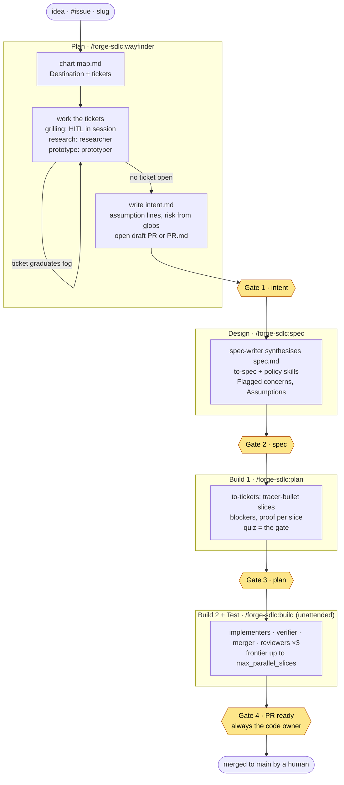
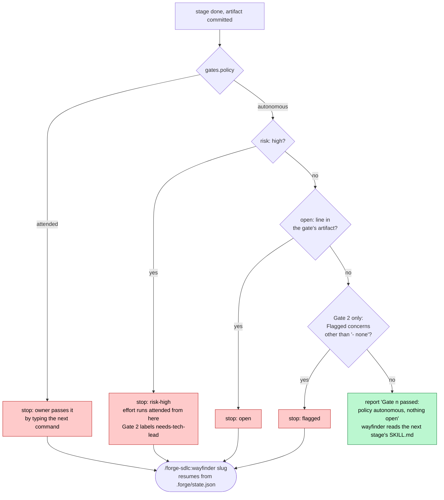
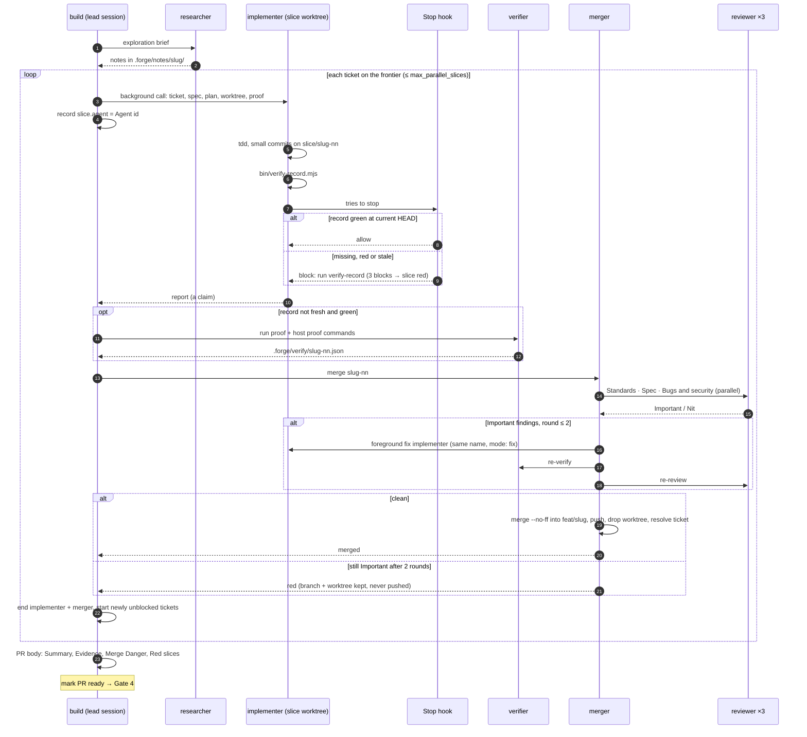
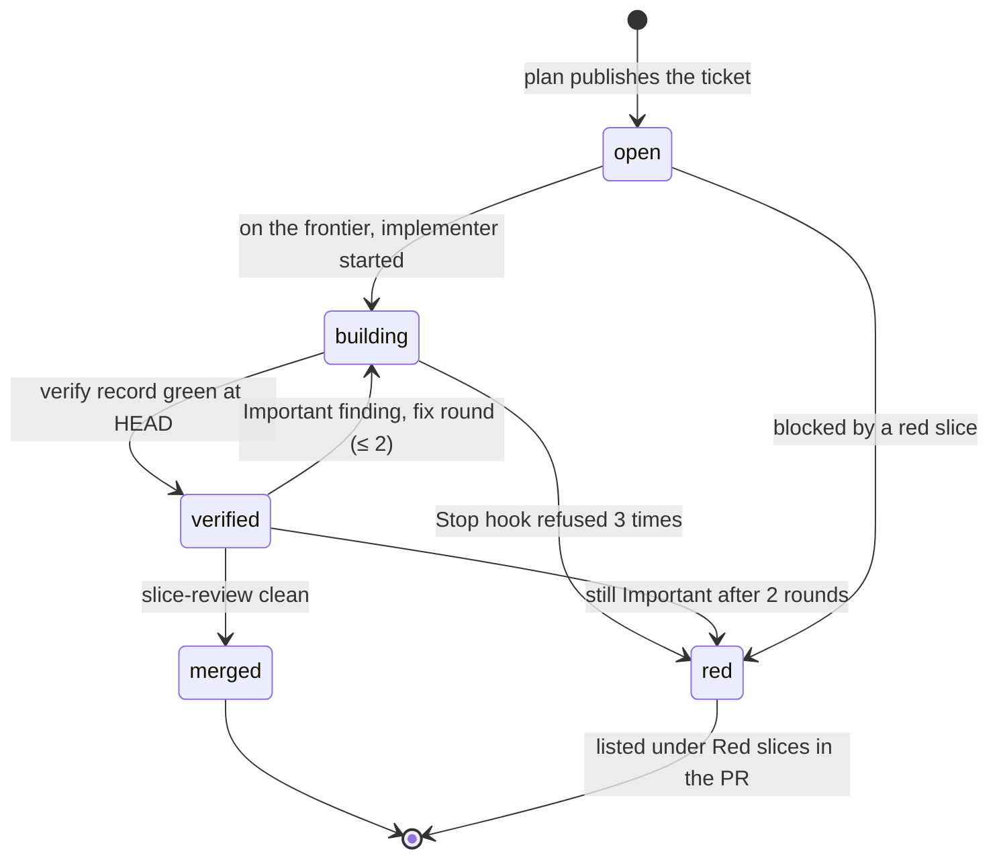
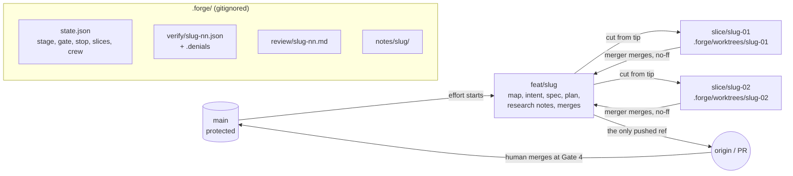
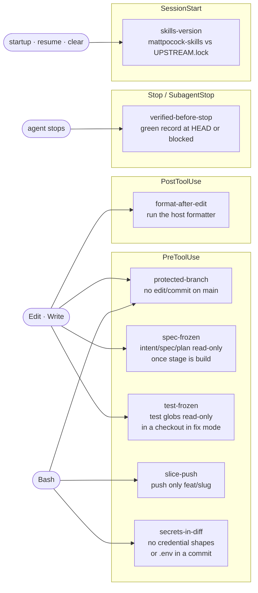

# How forge-sdlc works

Diagrams of the plugin as it stands after `feat/autonomous-gates` (ADR 0018). The rules behind them live in [design.md](design.md), the names and schemas in [contracts.md](contracts.md), the gate rule in [GATE-POLICY.md](../plugins/forge-sdlc/skills/wayfinder/GATE-POLICY.md). Where a diagram and those files disagree, the files win.

## 1. The loop, end to end

One effort is one folder `docs/efforts/<slug>/`, one pushed branch `feat/<slug>`, one PR. `/forge-sdlc:wayfinder` is the front door: it starts an effort from an idea or issue, and resumes one from its slug. Yellow hexagons are gates.

## 2. Who passes a gate

`## Gates` → `policy` in the host's `docs/agents/forge.md`. This repo runs `autonomous`, so a single `wayfinder` run goes from idea to the first stop or Gate 4.

A stop writes `stop: open | flagged | risk-high` beside `gate` in `.forge/state.json`; every other stage write drops it. Under `attended`, Gate 2 still honours `spec: only-on-open`. At Gate 3 under `autonomous` the quiz answers itself: four `recommended:` lines in `plan.md`'s `## Quiz`, copied under the PR's slice table for review at Gate 4.

## 3. Inside a build

Every agent is a **member call** ([MEMBERS.md](../plugins/forge-sdlc/skills/build/MEMBERS.md)): named by `bin/crew-name.mjs` from the host's crew theme, a visible pane under a `cmux claude-teams` lead, a subagent under a plain one.

### A slice's life

## 4. Branches and where things live

## 5. What the hooks enforce

Skills advise, hooks enforce. Each hook reads `.forge/state.json`, `docs/agents/forge.md` and git, never the conversation.

## 6. Commands at a glance

| Command | Does |
| --- | --- |
| `/forge-sdlc:init` | once per host: writes `docs/agents/forge.md`, the CLAUDE.md delivery-loop block, gitignores `.forge/` |
| `/forge-sdlc:wayfinder <idea \| #issue \| slug>` | the front door: starts or resumes an effort and runs to the next stop |
| `/forge-sdlc:intent <slug>` | reshape a charted map's Destination by hand |
| `/forge-sdlc:spec <slug>` · `plan <slug>` · `build <slug>` | rerun one stage by hand |
| `/forge-sdlc:slice-review <slice-branch>` | the merger's three-axis review, by hand |
| `/forge-sdlc:status [slug]` | read-only: stage, gate, stop, next command, frontier, red slices |
